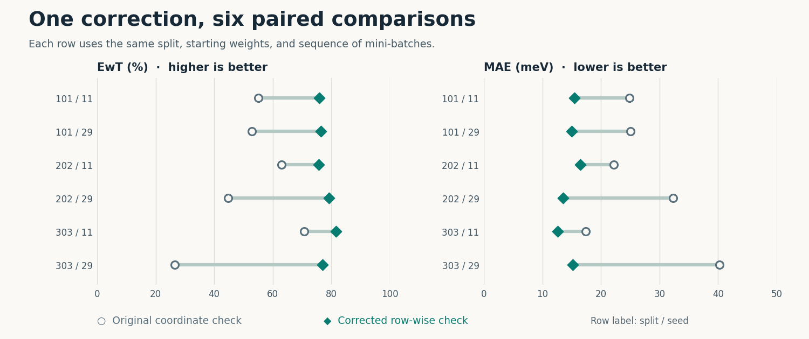

# MEGNet · исправление проверки координат

**С 52,14% до 77,59%** выросла доля точных прогнозов ширины запрещённой зоны после исправления геометрической проверки в предобработке кристаллов IDAO 2022. Здесь можно проверить результаты по шести парам и запустить любую из 12 обученных моделей.

| На тестовой выборке | Исходная проверка | Исправленная | Разница |
|---|---:|---:|---:|
| Ошибка прогноза < 0,02 eV (EwT) | 52,14% | **77,59%** | **+25,45 п.п.** |
| Средняя абсолютная ошибка (MAE) | 27,02 meV | **14,72 meV** | **−12,30 meV** |

## Что было не так?

При проверке существования точки исходный предобработчик искал каждое из трёх чисел сразу **во всех строках** массива. Например, точки (0.1, 0.8, 0.7) и (0.9, 0.2, 0.3) ошибочно дают совпадение с (0.1, 0.2, 0.3): числа нашлись, но принадлежат разным точкам.

Вместо этого сравниваем полные тройки, сохраняя принятое округление до пяти знаков:

~~~python
matched = np.any(np.all(defect_coords == ideal_point, axis=1))
~~~

Исправление изменило представления **14 из 2966 структур**. Поскольку модель обучалась заново, изменения прогнозов не ограничились этими 14 объектами.

## Сравнение

Три случайных разбиения, по два начальных состояния на каждом. Внутри пары модели начинали с одинаковых весов и получали одинаковый порядок мини-батчей во всех 120 эпохах. Обе метрики улучшились во всех шести парах: прибавка EwT составила от **+10,92 до +50,32 п.п.** Это результат отдельной MEGNet на одном наборе IDAO, а не оценка полного ансамбля или внешнего теста.

[Все шесть пар и протокол](docs/experiment.md) · [Таблица CSV](results/paired-results.csv) · [Обученные веса](weights/)

## Проверить числа

~~~bash
python score.py
~~~

Для пересчёта метрик из [абсолютных ошибок](results/test-errors.csv.gz) достаточно стандартного Python; скачивать исходные данные и устанавливать TensorFlow не нужно.

## Запустить модель

Для загрузки весов используйте Python 3.9 на CPU:

~~~bash
python3.9 -m venv .venv
. .venv/bin/activate
python -m pip install -r requirements.txt
python -m unittest discover -s tests -v
~~~

Скачайте [публичный архив IDAO](data/README.md), затем:

~~~bash
python prepare_data.py dichalcogenides_public.tar.gz
python experiment.py verify --split 101 --seed 11 --variant corrected
~~~

Последняя команда заново строит графы, загружает контрольную точку и сравнивает 467 абсолютных ошибок и решений по порогу EwT. [Как переобучить все варианты](docs/experiment.md#переобучение).
